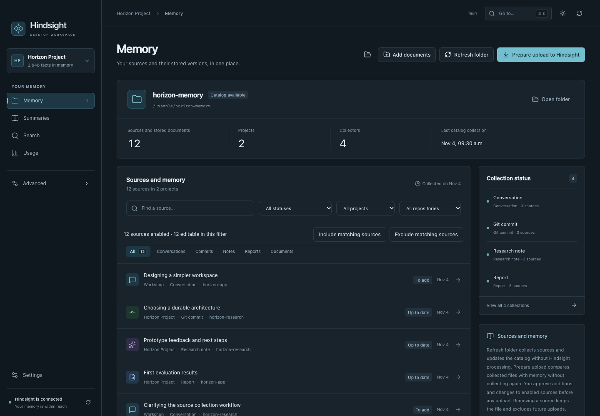

# Hindsight Desktop

**An independent macOS client for [Hindsight](https://github.com/vectorize-io/hindsight).**
Browse local sources, search memories and manage your server in a simple desktop
interface. A free community beta under the [MIT license](LICENSE), with no
official affiliation with Vectorize AI, Inc.

[Download](https://github.com/paabL/hindsight-desktop/releases) · [Privacy](PRIVACY.md) · [Report a bug](https://github.com/paabL/hindsight-desktop/issues)



## Install

**Requires macOS 15 or newer.** Download the file for your Mac from
[Releases](https://github.com/paabL/hindsight-desktop/releases), open the DMG and
drag **Hindsight Desktop** into **Applications**. Only architectures explicitly
listed in the release are supported. No developer tools are needed to run it.

This early beta is **not notarized by Apple**. After trying to open it, macOS may
require **System Settings → Privacy & Security → Open Anyway**. Only approve a
download whose source you have verified. [Apple's instructions](https://support.apple.com/102445).
Do not disable macOS security protections.

## Get started

1. Open the app. The interface uses English by default; French is available in
   **Settings → Interface language**.
2. In **Settings**, enter the address of an existing Hindsight server
   (`http://127.0.0.1:8888` for a local server). Recent features target API 1.2.0;
   availability depends on your server.
3. Choose a memory bank, or browse a local memory folder without a server.
4. Review your sources and the preview, then confirm an upload to Hindsight.

The app **does not include the server or model weights**. Follow the
[official server setup documentation](https://hindsight.vectorize.io).
Optional local collectors require separate configuration. Model calls can incur
fees according to your server settings.

Deletions and processing actions require confirmation in the app. Your server
may send uploaded content to its configured model providers. Read
[Privacy](PRIVACY.md) before importing sensitive information.

## Help and updates

- [Report a bug](https://github.com/paabL/hindsight-desktop/issues) without private
  conversations, credentials or complete logs.
- [Report a security vulnerability privately](SECURITY.md).
- Install future app versions from [Releases](https://github.com/paabL/hindsight-desktop/releases).
  Rebuilding from source in Settings is an advanced option for developers.

## Develop

Tauri 2 + React / TypeScript, with an internal Swift engine. Development requires
macOS 15+, Node.js 22.18+, Xcode 16+ / Swift 6 and stable Rust.

```sh
cd desktop
npm ci
npm run dev
```

```sh
# From the repository root
swift test
cd desktop
npm run bridge:build
npm test
npm run build
npm run tauri:build -- --bundles app,dmg
```

The bundle includes the native bridge. See the [technical guide](desktop/README.md),
[testing guide](docs/TESTING.md), [interface notes](docs/UI.md) and
[third-party notices](THIRD_PARTY_NOTICES.md).
API models are generated from `docs/openapi.json`.
