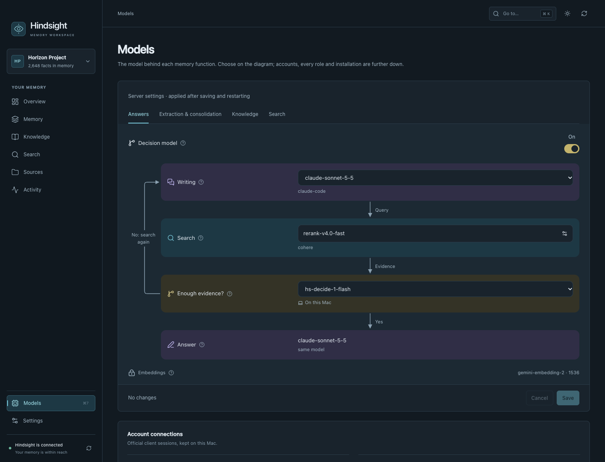
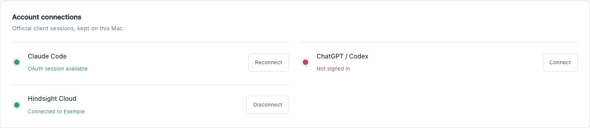

# Model settings diagram

**Models** sits at the bottom of the sidebar, next to Settings, and is available without a selected memory bank. It is the only place for model settings. The diagram at the top offers quick selectors and explanations. Under it, on the same page: account connections, **All roles and advanced settings** (collapsed) for providers, keys, endpoints, custom models and per-operation overrides, and **Model installation and services** (collapsed). Everything shares one draft, and the diagram's settings buttons open the matching role.

The diagram shows the launch-script draft, not the state of an already running process. Save reviews the changes through the existing confirmation; applying the saved settings restarts the server through a separate confirmed action. Bank-specific behavior settings can override server defaults.

In **Answer**, one reflection model writes search queries and the final answer. Without a specialized decision model, search results return to that model, which decides whether to search again. With one, the decision model filters evidence and checks sufficiency; insufficient evidence returns to reflection for another query. These are simplified paths: budget limits and server fallback behavior still apply.

**Search** ranking and **Answer** evidence evaluation are independent. Hindsight's global decision provider does not automatically replace recall's reranker. Search must explicitly select it. When enabled, the Answer diagram links its ranking stage to Search. A per-operation model, URL or key override is displayed as a separate configuration rather than falsely labelled as shared. Pages use the reflection decision client; their two behavior flags remain available in advanced settings.

Each role has a short explanation on hover, keyboard focus or tap. Provider changes, custom model identifiers, vision, default models, keys and per-operation overrides are in the role cards under the diagram. Installation/start/stop and Cloud connection controls remain available under model services. Quick selection offers existing model choices and keeps unconnected Cloud destinations unavailable. Embeddings are read-only in the diagram.

The diagram prepares only allowed model names and decision flags, with an optimistic revision check against the current script draft. It cannot change embeddings, credentials or endpoints through the batch command. Dynamic shell values must be edited explicitly through advanced settings. No selection triggers ingestion, inference or a server restart.

In a role card, Provider and Model are dropdowns. Switching provider updates the model menu inside the modal, without changing the native draft until Prepare is selected. The menus include configured custom providers/models and the existing native catalog; Codex also uses its local public model catalog. Cancel discards these modal choices. Provider-specific embedding and reranker fields remain independent.

Only the selected provider's applicable advanced fields are shown. **Other model…**
opens an explicit custom-name field when a configured identifier is not in the
catalog. This is separate from choosing an existing model in the quick view.

Green means a session is available or the account is signed in. Red means
disconnected, unavailable or failed; amber means checking or connecting; gray
means unchecked. The status text remains visible. These indicators do not test
whether a particular model is accessible or whether subscription quota remains.

Validation:

- `swift test --disable-sandbox -c release --filter 'ModelWorkflowTests|ServerSettingsViewModelTests'`
- `cd desktop && npm run bridge:build && npm test`
- `cd desktop && node tests/model-workflow-ui.mjs`
- `cd desktop && npm run test:models && npm run test:navigation && npm run test:i18n`

The native test uses temporary launch scripts and a local HTTP fixture, verifies confirmation and replay protection, and checks that existing embedding lines and secrets are preserved. Browser checks use only the fictional demo state.

## Local models and service recovery

For Hindsight models on your Mac, use the **On this Mac** choices: the decision
model uses the local service on port 8766; the local reranker uses provider
`local` with `hindsight-ai/hs-rerank-1`. Provider `hindsight` for reranking means
Hindsight Cloud and requires its account or key. Existing embeddings are separate.
New Cloud selections without an explicit credential or connected account cannot
be saved over a working script.

The advanced decision editor groups fields into Model, Search, Answer,
Consolidation and Pages. Technical options are collapsed; the footer stays visible.
The service shows startup progress and keeps polling while offline. Startup errors
appear beside its controls, including errors from a literal log redirection in the
launch script. A successful managed restart clears the pending-restart notice only
for the exact saved script that started.

Managed launch agents enable the bank LLM diagnostic by default. The diagnostic
endpoint is available; running a diagnostic is still an explicit action and may
call your configured providers. An explicit script setting can disable it.
