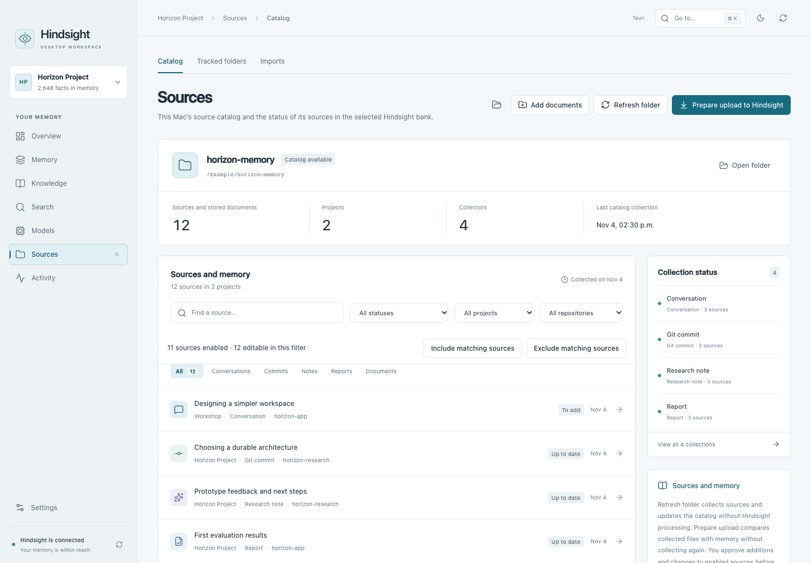

# Hindsight Desktop quick guide

## Start

You need macOS 15 or newer on an Apple Silicon Mac (M1 or newer).
[Install the app](../README.md#install). Hindsight Desktop connects to an existing
Hindsight server; it does not include the server or models.

Open **Settings → Application**, enter your **Server address**, then select
**Apply and reconnect**. Choose a bank from the menu at the top left.
If needed, create one in **Settings → Memory bank → New bank**.
**Overview** summarizes that bank’s memory and processing status.

## Everyday use

- **Sources → Tracked folders** lets you add files from ordinary folders. Choose
  **Track a folder**, select files and choose **Send**, then review and confirm.
  **Catalog** opens an existing, configured memory folder; use **Prepare upload
  to Hindsight** for its collected sources. Optional collectors require separate
  configuration.
- **Memory** shows what the selected bank has stored. Its tabs open **Facts**,
  **Documents**, **Timeline** and **Graph**. Open available source documents to
  check where a fact came from.
- **Knowledge** contains knowledge pages and mental models: summaries of what
  the bank knows about a topic.
- **Search** offers **Find facts**, **Exact text** and **Ask memory**. The first
  two find stored information; **Ask memory** generates an answer from it.
- **Models** lets you choose models quickly and explore their roles in the memory
  workflow. Hover or focus a role for a short explanation. **Manage models** opens
  Settings for providers, installation and advanced configuration. Prepared choices
  are preserved between both views; saving and restarting remain separate actions.
- **Activity** groups **Processing**, **Usage** and **Logs**. Check these when
  an upload is waiting or a request fails.

Model actions can incur provider fees. Review the estimate and confirmation
before generating or refreshing knowledge or asking for an answer.

## Choose models

Open **Models** in the sidebar and choose **Answer**, **Remember**, **Pages** or
**Search**. Select a model in the diagram; hover or focus a role for its explanation.
The decision switch applies to the selected function. Search ranking and Answer
evidence checks are separate choices. In Answer, the return arrow means another
search is needed before an answer can be written.

Choose **Save**, review the changes and confirm. The server uses the new settings
after a separate restart. The diagram shows your prepared settings; bank-specific
overrides can still apply. Its embedding display is read-only.

**Manage models** opens **Settings → Server & models** for accounts, providers,
installation and advanced options. Provider and Model are menus; changing the
provider updates the available models. Select **Prepare these changes** to add
them to the shared draft, or **Cancel** to discard the dialog's edits.

Account indicators are green for an available session, red for a disconnected or
unavailable account, amber while checking or connecting, and gray when unchecked.
A green indicator does not test model access or subscription quota.

## Browse and update Sources

The local list appears before the server comparison finishes. **Unchecked status**
means verification is pending or unavailable; it does not mean the source is up
to date. Source selection controls become available after the initial check.
You can browse and filter while verification or collection runs.

| Action | What it does |
| --- | --- |
| **Refresh view** in the top bar, or `⌘R` | Rechecks existing files against the selected bank; does not run collectors. |
| **Refresh folder** | Runs the configured collectors and updates local archives in the background; does not upload to Hindsight. |
| **Prepare upload to Hindsight** | Previews additions and changes from enabled sources; **Send** requires confirmation. |

Opening a source shows its text and provenance. **Stored version** reads the copy
in Hindsight; **Current source** returns to the local file. Changing inclusion
keeps the reader open. Excluding a source prevents future uploads but keeps its
stored copy; **Remove from memory** is a separate, confirmed action.

**Separate archives** keeps internal reviews and empty exports accessible.
Documents already in the bank can be linked to a matching local source.

## Shortcuts

`⌘K` opens quick navigation, `⌘R` refreshes the current view and `⌘,` opens
Settings. `⌘1…7` opens Overview, Memory, Knowledge, Search, Models, Sources and
Activity respectively.

## Preferences and updates

The bank menu opens **Memory bank settings** for bank management and
**Directives**, or **Memory behavior** for memory, consolidation and answer
missions.

In **Settings → Application**, choose French under **Interface language**.
The app starts in English; your documents keep their original language.

Under **Application updates**, choose **Check for updates**, then
**Update and restart** when a new version is available. Checks and installation
start only when you request them.
