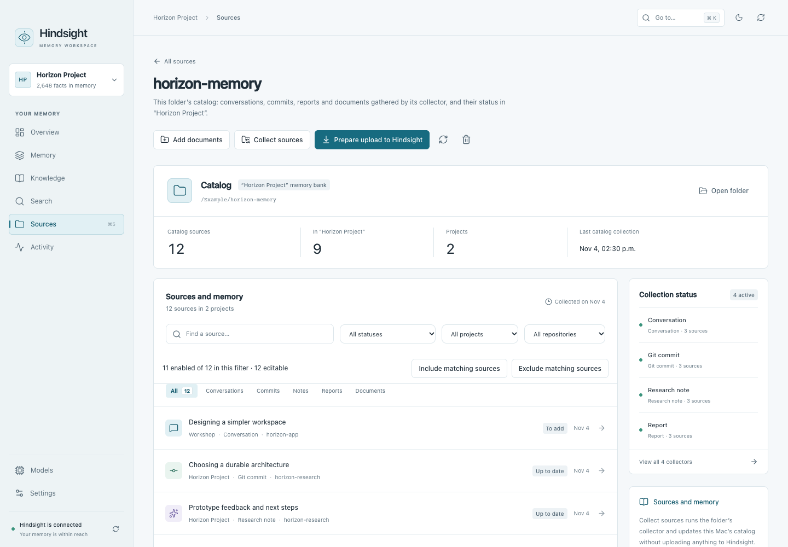

# Hindsight Desktop quick guide

## Start

You need macOS 15 or newer on an Apple Silicon Mac (M1 or newer).
[Install the app](../README.md#install). Hindsight Desktop connects to an existing
Hindsight server; it does not include the server or models.

Open **Settings → Server**, enter your **Server address**, then select
**Apply and reconnect**. Choose a bank from the menu at the top left.
If needed, create one in **Settings → Memory bank → New bank**.
**Overview** summarizes that bank’s memory and processing status.

## Everyday use

- **Sources** lists the folders on this Mac that feed the selected bank. Choose
  **Add a folder**, open it and choose **Upload all**, or select files and choose
  **Upload**, then review and confirm. Each bank has its own folders; the same folder can feed several banks.
  A folder with a catalog (`catalog.json`, gathered by its `collect.py` collector)
  opens on its catalog instead: use **Prepare upload to Hindsight** for its
  collected sources. Collectors require separate configuration.
- **Memory** shows what the selected bank has stored. Its tabs open **Facts**,
  **Documents**, **Timeline** and **Graph**. The search in Facts covers the whole
  bank; the type menu narrows it at once. Open available source documents to check
  where a fact came from.
- **Knowledge** contains knowledge pages, kept up to date by the server, and
  mental models, which follow a question you ask. Each card names its kind.
- **Search** offers **Find facts**, **Exact text** and **Ask memory**. The first
  two find stored information; **Ask memory** generates an answer from it.
- **Models** holds every model setting: the diagram of their roles in the memory
  workflow, account connections, all roles and installation. Hover or focus a role
  for a short explanation. Saving and restarting remain separate actions.
- **Activity** groups **Processing**, **Usage** and **Logs**. Check these when
  an upload is waiting or a request fails. **Processing** is where you pause or
  resume the bank's processing; ⋯ offers the other options.

Model actions can incur provider fees. Review the estimate and confirmation
before generating or refreshing knowledge or asking for an answer.

## Choose models

Open **Models** in the sidebar and choose **Answer**, **Remember**, **Pages** or
**Search**. Select a model in the diagram; hover or focus a role for its explanation.
The decision switch applies to the selected function. Search ranking and Answer
evidence checks are separate choices. In Answer, the return arrow means another
search is needed before an answer can be written.

Choose **Save**, review the changes and confirm. The server uses the new settings
after a separate restart. The diagram shows your prepared settings; bank-specific
overrides can still apply. Its embedding display is read-only.

Under the diagram, on the same page, are account connections, **All roles and
advanced settings** for providers, keys and custom models, and **Model installation
and services**. Provider and Model are menus; changing the provider updates the
available models. Select **Prepare these changes** to add them to the shared draft,
or **Cancel** to discard the dialog's edits.

Account indicators are green for an available session, red for a disconnected or
unavailable account, amber while checking or connecting, and gray when unchecked.
A green indicator does not test model access or subscription quota.

## Feed a bank from this Mac

**Sources** lists the folders that feed the selected bank, with what remains to
upload. **Add a folder** adds one for this bank only. Open an ordinary folder to
compare its files with the bank. **Upload all** sends every file not yet sent,
modified or without facts; to send only some, select them and choose **Upload**.
Every upload is confirmed. With files selected, **Remove from memory** deletes
their documents from the bank after confirmation.
Only documents are compared unless you include all text files for that folder.

## Browse and update a catalog

A folder with a catalog belongs to the bank named in its `memory-policy.json`;
in another bank it is an ordinary folder. The local list appears before the
server comparison finishes. **Unchecked status**
means verification is pending or unavailable; it does not mean the source is up
to date. Source selection controls become available after the initial check.
You can browse and filter while verification or collection runs.

| Action | What it does |
| --- | --- |
| **Refresh view** in the top bar, or `⌘R` | Rechecks existing files against the selected bank; does not run collectors. |
| **Refresh folder** | Runs the configured collectors and updates local archives in the background; does not upload to Hindsight. |
| **Prepare upload to Hindsight** | Previews additions and changes from enabled sources; **Send** requires confirmation. |
| **Check Hindsight status** | Rechecks the bank inventory without collecting or uploading sources. |

Opening a source shows its text and provenance. **Stored version** reads the copy
in Hindsight; **Current source** returns to the local file. Changing inclusion
keeps the reader open. Excluding a source prevents future uploads but keeps its
stored copy; **Remove from memory** is a separate, confirmed action.

**Separate archives** keeps internal reviews and empty exports accessible.
Documents already in the bank can be linked to a matching local source.

The separate native conversation importer has been retired. Previously stored
conversations remain readable in the generic catalog and document views.

## Shortcuts

`⌘K` opens quick navigation, `⌘R` refreshes the current view and `⌘,` opens
Settings. `⌘1…7` opens Overview, Memory, Knowledge, Search, Sources, Activity and
Models respectively.

## Preferences and updates

The bank menu opens **Memory bank settings** for bank management and
**Directives**, or **Memory behavior** for memory, consolidation and answer
missions. Each Memory behavior tab shows the essentials; finer settings are under
**Advanced options**, which marks changed values and values specific to the bank.
**Reset to server settings** removes every value specific to the bank.

**Settings → Server** holds the server address and, for a server on this Mac, its
service, launch script, backups and log.

In **Settings → Application**, choose French under **Interface language**.
The app starts in English; your documents keep their original language.

Under **Application updates**, choose **Check for updates**, then
**Update and restart** when a new version is available. Checks and installation
start only when you request them.
